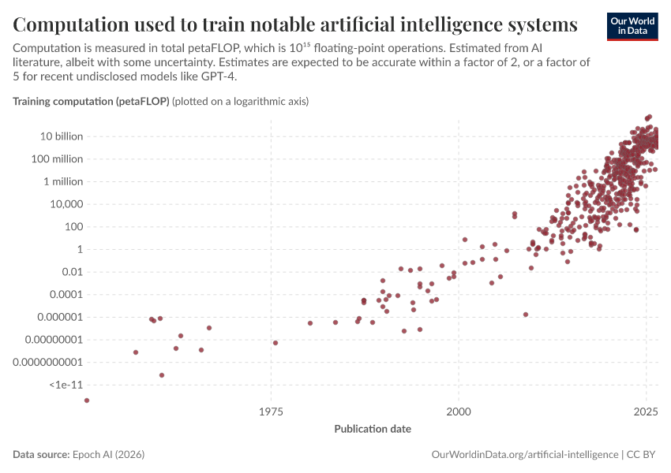
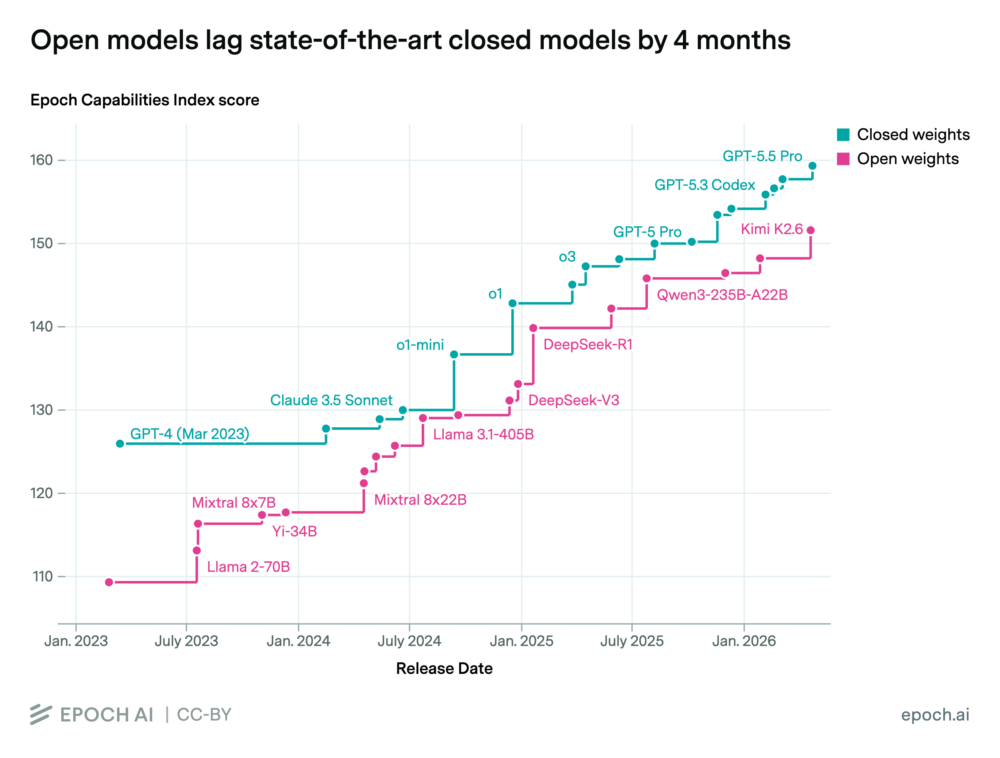
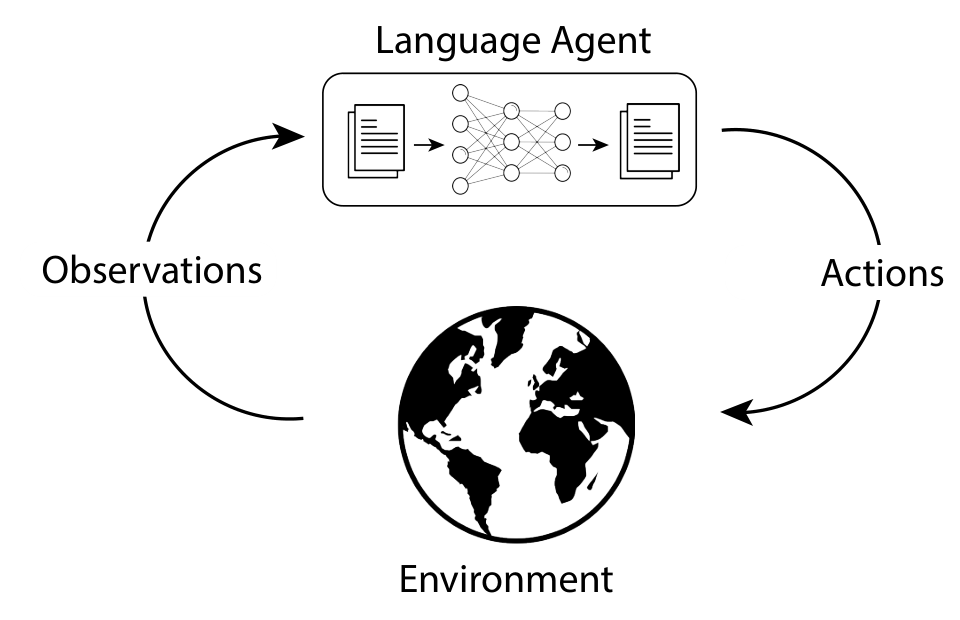
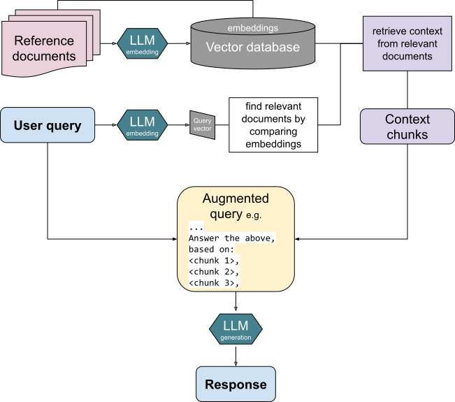

<!-- _class: lead workshop-cover -->
<!-- _paginate: false -->

# Agentic Practices Workshop
## for data analysis and visualization

Dimitrios S. Kanakoglou &amp; Peter Wad Sackett With HALp, our workshop helper

Hands-on, surface 2 h 30 min, in-depth a day or more

---

# AI is here to stay

The largest AI training run of 2025 used about **ten billion times** the compute of the largest in 2010.

The ship for not liking it has sailed: AI is in our tools, our reviewers' tools and our students' work. The question is **how to use it well**, and how to verify the correctness of its results. This is what today is about.

<!-- Largest in the chart's data: 2010, RNN LM, 54 petaFLOP; 2025, Grok 4, 5e11 petaFLOP; ratio 9.3e9. Figure: Our World in Data, "Computation used to train notable artificial intelligence systems", data from Epoch AI (2026), CC BY. https://ourworldindata.org/grapher/artificial-intelligence-training-computation -->

Figure: Our World in Data, data from Epoch AI (2026), CC BY

---

# What a large language model is

A **large language model (LLM)** is trained on huge amounts of text to do one thing: predict the next **token**, a word or a piece of a word (in English, a token is roughly ¾ of a word).

Its knowledge sits in billions of numbers, the **weights**, fixed when training ends. Asked a question, it writes the most **plausible** continuation, one token at a time.

It does **not** look facts up. Just because something is plausible (according to the model), it does not necessarily mean it's true.

---

# What it knows, and what it doesn't

- **Training cutoff.** It knows nothing that happened after its training data was collected.
- **Context window.** Its only working memory: your prompt, the files it read, the tool results. From 16,000 tokens for smaller models to over a million for frontier.
- **Hallucination.** Fluent, confident text with no facts or knowledge behind it. It looks exactly like a correct answer.
- **Sampling.** The same question can get a different answer the next time.

Everything we build today works around these four facts.

---

# Closed, open-weight, and open-source models

| | You get | Examples |
|---|---|---|
| **Closed** | An API. The weights never leave the company | GPT-5, Claude, Gemini |
| **Open-weight** | The weights: download them and run them yourself | Qwen, Mistral, GPT-OSS, Llama, DeepSeek |
| **Fully open** | Weights, training data and code | OLMo |

The free OpenCode models you will be introduced to today are a mix, run by external providers.

---

# Why open weight models for research

- **Reproducible:** you pin exact weights; they do not change or disappear.
- **Private:** data can stay locally on your own hardware.
- **Inspectable:** you can read the model's probabilities (Exercise 4).
- **Close behind:** the best open models trail the closed frontier models by months, not years.

Figure: Epoch AI, "Open models lag state-of-the-art closed models by 4 months" (2026), CC BY

<!-- https://epoch.ai/data-insights/open-closed-eci-gap. Also cost and the option to fine-tune. Trade-off: the very best models are still closed, and running large open models needs serious hardware. -->

---

# Where your data goes

| Model | Runs on | Use it with |
|---|---|---|
| Local | Local servers | Workshop data, following local rules |
| Free OpenCode models (our default, Big Pickle) | External providers | Public data only. Some may train on your input |
| Your own subscription | That company | Whatever its terms allow |

Every file the agent **reads** is sent to the model, and so is every tool result. 
Free does not mean private.

---

# Today

| Time | Block | You will |
|---|---|---|
| 0:00 | Setup | Run `scripts/check-setup.sh`, say `/halp hello` |
| 0:10 | Concepts | These slides |
| 0:20 | Exercise 0 · RAG | Watch a model stop halluncinating once it gets the documents |
| 0:35 | Exercise 1 · Skills | Turn a repeated task into a tested skill |
| 1:05 | Exercise 2 · Agents | Add a plugin, compare two agents, run a team of five agents|
| 1:50 | Exercise 3 · MCP | Connect to a database and check the capabilities it provides |
| 2:00 | Exercise 4 · Decision model | Get typed answers with probabilities |
| 2:10 | Exercise 5 · Safety | Find an instruction hidden in a data file |
| 2:20 | Wrap-up | When to use an agent, and how to check one |

Each exercise stands alone and its README says what to do. 
Stuck? `/halp <exercise> <what you tried>`

---

# From chat to agent

A chatbot answers once from a prompt. 
An **agent** is the same model in a loop: it chooses an **action**, the action changes its **environment**, and what it **observes** goes back into its context for the next step.

In OpenCode, the actions are tool calls (read, edit, run, search), the environment is your laptop and its files, and the observations are the tool results. OpenCode, the harness, sits in between and asks you first.

Figure: Sumers, Yao, Narasimhan &amp; Griffiths, "Cognitive Architectures for Language Agents" (2023), arXiv:2309.02427, Fig. 1B, cropped. CC BY 4.0

<!-- https://arxiv.org/abs/2309.02427 -->

---

# Terms: the machinery

| Term | What it is |
|---|---|
| **Model** | The LLM that reads the context and proposes the next step |
| **Provider** | Who runs the model: Local, OpenCode, OpenAI, … |
| **Harness** | The program around the model. Today: **OpenCode**. It builds the context, runs the tools and enforces the rules |
| **Tool** | Something the agent can do: read a file, edit, run a command, search |
| **Permission** | A rule for each tool: *allow*, *ask* or *deny* |

The harness employs tools and rules but these are not independent of the harness. 
However, you can change the model and keep the harness (along with the tools and the rules).

<!-- Sources: https://opencode.ai/v2/docs/ -->

---

# Terms: building blocks

| Term | What it is | Where it lives |
|---|---|---|
| **Skill** | Reusable instructions, with optional scripts, for one task | `.opencode/skills/<name>/SKILL.md` |
| **Agent** | A role: instructions, model, permissions, step limit | `.opencode/agents/<name>.md` |
| **Subagent** | An agent that another agent calls for one job | `mode: subagent` |
| **Team / swarm** | A coordinating master agent that splits a task and delegates it to specialist subagents | Exercise 2c |

An agent decides *which* skills and tools to use. 
A team adds hand-offs, and a reviewer agent that does not trust the others (adversarial agents).

<!-- Sources: https://opencode.ai/v2/docs/skills/ https://opencode.ai/v2/docs/agents/ -->

---

# Terms: extending OpenCode

| Term | What it is | Example today |
|---|---|---|
| **MCP server** | A capability **outside** OpenCode behind a standard protocol (Model Context Protocol). OpenCode starts it or connects to it | A DuckDB database you query in plain English |
| **Plugin** | Code that changes **OpenCode itself**. It runs with your permissions, unsandboxed | Sidebar Plus: shows what every agent is doing |

A skill is instructions. 
An MCP server is a separate program mostly associated with adding additional capabilities to agents. 
A plugin is foreign code executed in the harness: **LOOK** before you install it. Here lies dragons...

<!-- MCP: https://modelcontextprotocol.io. Plugins: https://opencode.ai/v2/docs/plugins/ -->

---

# Terms: techniques

**RAG** (retrieval-augmented generation): Framework that gives an AI model access to external data sources to find accurate information, allowing it to generate up-to-date and reliable answers without needing to be retrained. It also works as a safety measure against halluncinations. 
It cuts your document(s) into pieces, turns them into a vector (an **embedding**) and stores them. When prompted, it finds the pieces closest associated to it, and gives only those to the model, with ids that can be cited and traced.

The model only sees what you retrieved: in Exercise 0, about 800 tokens instead of 55,000.

Figure: "RAG diagram" by Turtlecrown (2024), Wikimedia Commons, CC BY-SA 4.0

<!-- https://commons.wikimedia.org/wiki/File:RAG_diagram.svg -->

---

# Terms: miscellaneous

| Term | What it is |
|---|---|
| **Decision model** | A model asked a *typed* question (yes/no, a choice, a score) whose answer comes with a probability, instead of a paragraph to interpret |
| **Prompt injection** | Instructions hidden in data the agent reads, aimed at the agent rather than at you |
| **Sandbox** | Isolation below the agent: a container without network, a locked-down runtime, docker, VM. |

---

# When is a task agent-suitable?

- The result can be **checked** independently: a known number, a test, a plot you can read.
- Failure is **cheap and visible**.
- You are ok with data leaving your computer.
  
Not suitable: no way to check the answer, irreversible actions, confidential data on external models.

---

# Limitations

- **Halluncinations:** A confident answer with no evidence behind it - looks like any other answer.
- **Correct numbers, misleading picture:** Every value right, the conclusion wrong.
- **Success that was never verified:** "Done" is a claim, not evidence.
- **Instructions in the data:** The agent reads everything as text.

**"Code generated" ≠ "it ran" ≠ "it is correct" ≠ "the science holds".**

---

<!-- _class: lead -->

# Thank you

Material: github.com/WorkshopAgency/AgenticWorkshop

Dimitrios S. Kanakoglou · dimkan@dtu.dk Peter Wad Sackett · pwsa@dtu.dk
